  

  
  
  

---

### About

I work where **institutional finance meets software**. My background spans institutional RFPs and DDQs at **Goldman Sachs**, municipal credit underwriting and SME equity research. I build **Python and web tools** that take the manual work out of that analysis.

- 🏦 **Goldman Sachs, RFP Analyst:** RFP & DDQ submissions across Europe and Asia that secured **$340M+** in new mandates. I also wrote Python migration scripts that cut manual due-diligence effort by **40%**.
- 📑 **Credit Consultant:** credit appraisal and underwriting of unsecured municipal infrastructure loans under the CRGSS scheme, with NCGTC guarantee administration.
- 📈 **Equity Research:** **50+** SME research reports with DCF and relative valuation on Bloomberg Terminal, plus pre-IPO RHP/DRHP audits.
- 🎓 B.Com (Finance & Marketing), Bangalore University · **NISM Series XV, Research Analyst**

**Current focus:** fintech and quant tooling (portfolio analytics, backtesting, data pipelines) for Indian markets.

---

### Featured work

| Project | What it does | Stack |
| :-- | :-- | :-- |
| **[Mutual Fund Overlap Analyser](https://mfoverlap.com)** · live | Client-side ISIN deduplication across **14,000+ AMFI schemes (44+ AMCs)** that shows how much two funds' holdings overlap. Found **~74%** overlap in live portfolio tests. | `Python` `Astro` `Data Eng.` |
| **[Gratuity Calculator India](https://mygratuityindia.pages.dev)** · [source](https://github.com/Ashishkashyap1/Gratuity-Calculator-Website) | Production micro-SaaS that calculates gratuity under the Payment of Gratuity Act, 1972, including the Sec. 10(10) tax exemption. Private, instant and built for technical SEO. | `Astro` `Tailwind` `Cloudflare Pages` |
| **[Quantitative Backtesting Suite](https://github.com/krayzius-wolf/AlgoTradeSystem)** *(co-developed)* | CLI that backtests and optimises RSI/SMA strategies on NSE equities using live broker-API candle data, with batch reports across a top-250 large & mid-cap universe. | `Python` `backtesting.py` `TA-Lib` `SmartAPI` |
| **[ClarifyCare](https://clarifycare.in)** · live | D2C storefront for an Indian organic body-care brand. A headless Next.js front end reads prices and stock from the WooCommerce Store API, with a skin quiz that maps city, concerns and skin type to a routine. | `Next.js` `React` `Tailwind` `Zustand` `WooCommerce` |
| **[LITSEARCH: AI-Native Job Search](https://github.com/Ashishkashyap1/J-Go-AI-Native-Job-search)** | Parses a CV, searches 7 job portals, scores each listing out of 100 behind a maker-checker QC gate, and exports a 5-sheet Excel report with a skills-gap analysis. | `Python` `Playwright` `PyMuPDF` `openpyxl` |
| **Qvidian Migration Automation** *(Goldman Sachs, internal)* | Python pipelines that migrated legacy RFP and DDQ content into Qvidian, cutting manual due-diligence effort by 40% on the alternatives desk. | `Python` `Data pipelines` |

---

### Toolkit

**Engineering** 

**Finance & analytics** 

**Domain** 

---

### GitHub at a glance

  
  

<!-- Streak card: enable once you have a regular commit streak (it currently shows a 2-day longest streak).

  

-->

---

  Bengaluru, India · Open to fintech, credit and quantitative roles · <a href="https://ashishkashyap1.github.io">ashishkashyap1.github.io</a>

